<picture>
  <source media="(prefers-color-scheme: dark)" srcset="assets/header-dark.svg">
  <source media="(prefers-color-scheme: light)" srcset="assets/header-light.svg">
  
</picture>

  
  
  

## 👋 Hi, I'm Maham

I'm an AI Software Engineer at **[The Botss](https://thebotss.com)**, where I ship AI products that real customers use every day: support agents that answer on WhatsApp and Instagram, voice agents you can phone, and RAG systems grounded in a company's own data.

On the side I build open-source tools to understand how AI developer tools work from the inside.

## ✨ Open source I'm building

<table>
  <tr>
    <td width="50%" valign="top">
      
      <h3><a href="https://github.com/mahamsultana/polycast">PolyCast</a></h3>
      
<b>Write a script. Get a low-poly 3D video.</b> A host and a sarcastic AI orb banter in a podcast studio, with generated voices, real lip-sync, word-cued camera cuts and captions, rendered with three.js in headless Chrome. Works as a skill for Claude Code, Codex and other agents.

      
      
      
    </td>
    <td width="50%" valign="top">
      
      <h3><a href="https://github.com/mahamsultana/mahi-code">Maham Code</a></h3>
      
<b>An AI coding agent, built from scratch.</b> Describe a change and it explores your project, reads what it needs, and writes and edits code across the codebase. One Python core runs in the terminal, as a desktop app and inside VS Code, on any OpenAI-compatible model, including local ones.

      
      
      
    </td>
  </tr>
</table>

## 🚀 Shipped in production

| Product | What I built | Impact |
|---|---|---|
| **[Commify AI](https://commify.ai/)** | AI support for Shopify stores across WhatsApp, Instagram, Messenger and a storefront widget, grounded in each store's data with RAG | Automates **70%+** of customer queries, cut return-to-origin from **31% to 12%** |
| **[Arthur](https://arthur.amazon1.org/)** | Multilingual voice and chat agent (English, German, Russian) you can call by phone, with pgvector retrieval and a NestJS backend | Serves about **3,000 users** |
| **Accident Assist AI** | AI legal-intake app for US accident victims: an Agents SDK assistant builds case files through tool calling and routes leads to lawyers | Live on the **App Store** and **Google Play** |

## 🛠️ Tech I work with

  <b>AI</b>&nbsp;
  
  
  
  
  
  

  

## 💼 Experience

- **Software Engineer, [The Botss](https://thebotss.com)** · Jan 2025 to now · AI agents, RAG, voice and full-stack products
- **Software Engineer, Zenkoders** · Aug to Dec 2024 · web apps, a reusable component library, real-time WebSocket chat
- **BS Computer Science, Sir Syed University (SSUET)** · graduated 2025

## 📈 Activity

  <picture>
    <source media="(prefers-color-scheme: dark)" srcset="https://streak-stats.demolab.com/?user=mahamsultana&theme=dark&hide_border=true&background=0a0a0c&ring=ff8a3d&fire=ff8a3d&currStreakLabel=ff8a3d">
    
  </picture>

  Want to build something with AI? <a href="mailto:mahamsultanaa@gmail.com">Let's talk</a>.

